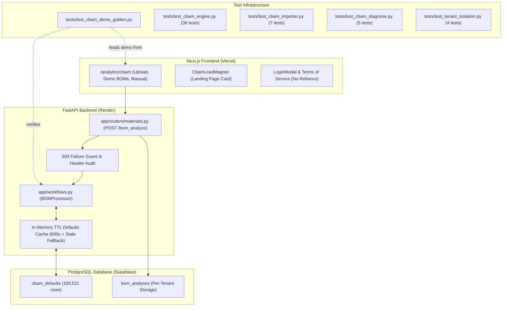

# CBAM Operations, Maintenance, and Regulatory Update Guide

> **Document Purpose:** Practical standard operating procedure (SOP) for maintaining, updating, testing, and operating the MatDataHub CBAM Cost Estimator. Follow these steps whenever the European Commission publishes updated default emission factors, Combined Nomenclature (CN) revisions, or when preparing for commercial pilot walkthroughs.

---

## 1. System Architecture & Component Map

The CBAM estimator consists of four tightly-coupled components across backend, frontend, database, and test infrastructure:



### Critical File Locations:
* **Calculation Engine**: `app/workflows.py` (`BOMProcessor`, Annex I prefix rules, fuzzy matcher, unit parsing).
* **API Endpoints**: `app/routers/materials.py` (`analyze_bom`, `toggle_save_material`).
* **Frontend UI & Demos**: `next-frontend/src/app/analytics/cbam/page.tsx` (`DEMO_BOMS.automotive`, `DEMO_BOMS.construction`).
* **Lead Magnet & Copy**: `next-frontend/src/components/CbamLeadMagnet.tsx`, `next-frontend/src/components/LoginModal.tsx`.
* **Legal Disclaimers**: `next-frontend/src/app/terms/page.tsx`, `next-frontend/src/app/privacy/page.tsx`.
* **Raw Regulation Source**: `data/cbam_official/32026R1740.html` (EUR-Lex HTML with SHA-256 provenance).
* **Golden Regression Suite**: `tests/test_cbam_demo_golden.py`.

---

## 2. Regulatory Update Procedure (New Regulation / Commission Defaults)

The European Commission updates default emission factors periodically (annually or through correcting implementing acts) and updates the Combined Nomenclature (CN) in Annex I to Council Regulation (EEC) No 2658/87 every October.

When a new regulation is adopted (e.g., superseding Implementing Regulation (EU) 2026/1740 or (EU) 2025/2621):

### Step 2.1: Retrieve & Snapshot the Official Journal Text
1. Locate the official CELEX on [EUR-Lex](https://eur-lex.europa.eu/).
2. Save the raw official HTML to `data/cbam_official/<CELEX>.html`.
3. Record the SHA-256 checksum and retrieval timestamp in `data/cbam_official/<CELEX>.provenance.json`:
   ```json
   {
     "celex": "32026R1740",
     "act": "Commission Implementing Regulation (EU) 2026/1740",
     "amends": "Implementing Regulation (EU) 2025/2621, Annexes I and IV replaced",
     "source_url": "https://eur-lex.europa.eu/legal-content/EN/TXT/HTML/?uri=CELEX:32026R1740",
     "retrieved_at_utc": "2026-10-07T06:25:15Z",
     "sha256": "<hash>",
     "bytes": 16388255
   }
   ```

### Step 2.2: Verify Mark-up & Special Rules in Annex I Recitals
* **Regulatory Mark-up Schedule**:
  * Cement, Iron & Steel, Aluminium, Hydrogen: $10\%$ for 2026, $20\%$ for 2027, $30\%$ for 2028 onwards.
  * Fertilisers: $1\%$ for 2026 onwards.
* **Dash (`—`) Handling (Rule 108)**:
  * When a listed country shows `—` in its table (e.g. Turkey for `2523 29 00`), the engine must fall back to the "Other countries and territories" table and display the statutory explanation note, **not** advise the user to check spelling.
* **10-Digit Only Scope Guard**:
  * Verify commodities published exclusively at 10 digits (e.g. `2507 00 80 80` calcined kaolin, white vs. grey clinker under `2523 10 00` and `2523 90 00`).
  * If the Commission publishes only 10-digit rows, an 8-digit input must remain quarantined with `"Needs 10-digit CN code"`. Never let it fall through to generic estimates in strict mode.

### Step 2.3: Re-Run Importer & Refresh Cache
1. Update and execute the database importer script:
   ```powershell
   python scripts/import_cbam_defaults_2026_1740.py --year 2026
   ```
2. Verify total row count in database (expected $\approx 100\,521$ entries).
3. Invalidate the in-memory cache:
   ```python
   from app.workflows import invalidate_cbam_defaults_cache
   invalidate_cbam_defaults_cache()
   ```

---

## 3. Demo BOMs & Hand-Checked Golden Tests

The demo BOMs in `next-frontend/src/app/analytics/cbam/page.tsx` are the very first numbers a prospect or pilot customer will see. They must remain **100% hand-verified against the official regulation text**.

### Baseline Demo Values (2026 Reference Price: €75.00/t, Phase-in: 2.5%):

| ID | Commodity | CN Code | Origin | Base Total | $+10\%$ Mark-up | Quantity | 2026 Cost | Scope / Note |
|---|---|---|---|---|---|---|---|---|
| **MAT-A1** | Hot-Rolled Steel Coil | `7208 39 00` | China | 3.187 | **3.506** | 50,000 kg | **€328.66** | China 7208 table |
| **MAT-A2** | Aluminium Alloy Bar | `7604 29 10` | India | 3.413 | **3.754** | 15,000 kg | **€105.59** | India 7604 29 10 table |
| **MAT-A3** | Plastic Dashboard | *None* | Vietnam | — | — | 5,000 kg | **€0.00** | OUT OF SCOPE showcase |
| **MAT-A4** | Hexagon Bolts (Grade 8.8) | `7318 15 88` | Taiwan | 2.707 | **2.978** | 2,000 kg | **€11.17** | Taiwan 7318 15 table |
| **MAT-C1** | Portland Cement | `2523 29 00` | Turkey | 1.440 | **1.584** | 200,000 kg | **€594.00** | Global fallback (Turkey lists '-') |
| **MAT-C2** | Steel Rebar | `7214 20 00` | China | 3.169 | **3.486** | 100,000 kg | **€653.61** | China 7214 20 00 table |
| **MAT-C3** | Aluminium Frames | `7610 10 00` | China | 4.896 | **5.386** | 10,000 kg | **€100.98** | China 7610 10 00 table |
| **MAT-C4** | Railway Track Fasteners | `7318 15 20` | China | 6.375 | **7.013** | 5,000 kg | **€65.74** | China 7318 15 table ($2.35\times$ Taiwan) |
| **MAT-C5** | Glass Panes | *None* | India | — | — | 5,000 kg | **€0.00** | OUT OF SCOPE showcase |

> [!NOTE]
> If demo rows are modified or added in `page.tsx`, you **must** update `EXPECTED` and `REG` in `tests/test_cbam_demo_golden.py`. The golden test extracts the CSV directly from the TSX file; a mismatch will immediately fail the test suite.

---

## 4. Verification & Testing Checklist

Before deploying any changes to production, execute this complete verification sequence:

### 4.1 Backend Test Suites
Run all Python test suites from the repository root:
```powershell
python tests/test_cbam_demo_golden.py
python tests/test_cbam_engine.py
python tests/test_cbam_importer.py
python tests/test_cbam_diagnose.py
python tests/test_tenant_isolation.py
```
**Expected Outcome**: 5/5 golden pass, 36/36 engine pass, 7/7 importer pass, 5/5 diagnose pass, 4/4 tenant isolation pass (including 503 guard verification). Zero failures.

### 4.2 Frontend Typecheck & Build
Run full Next.js production build:
```powershell
cd next-frontend
npm run build
npx tsc --noEmit
cd ..
```
**Expected Outcome**: `21/21` static pages generated cleanly, zero TypeScript errors.

### 4.3 Live Deployment Audit (Post-Deploy)
After pushing to `main`, verify the live Render service (`https://matdatahub-api.onrender.com`):
1. **Health Check**:
   ```powershell
   Invoke-RestMethod -Uri 'https://matdatahub-api.onrender.com/health' -Method Get
   ```
   *Must return `{"status":"healthy","db_ready":true,"db_error":false}`.*
2. **Commit Hash Verification**:
   * Inspect the `engine_version` field in `bom_analyses.results_json` or response headers. It must match or succeed commit `966425b` (which added header normalization).
3. **Response Header Check**:
   * In browser DevTools Network tab on an upload, inspect:
     * `X-CBAM-Defaults-Count`: **Must equal 100521**.
     * `X-CBAM-Mode`: `strict=True,deminimis_disabled=False`.
4. **Behavioral Upload Verification**:
   * Upload test file with natural headers (`Material ID`, `Country of Origin`, `CN Code` = `2507008080`).
   * Expect: `Included = YES`, `Cost = €0.58`, `Basis = COMMISSION_DEFAULT`.

---

## 5. Risk Management & Commercial Beta Rollout Strategy

To prevent legal exposure from early customer reliance:

### 5.1 Free Labeled Beta Rules
* **Brand as Estimator Only**: Badge must read `"EU CBAM Cost Estimator (Beta)"`. Never claim the tool certifies compliance.
* **No Paid Enterprise SLAs**: Keep initial importer access free and framed as an exploratory beta.
* **No-Reliance Terms**: Ensure the sign-up modal links to the Terms of Service with the explicit no-reliance clause (Section 5).

### 5.2 Broker-in-the-Loop Validation
* Ask each beta customer to have their existing customs broker review MatDataHub's exported calculation against their actual customs filing.
* Treat any discrepancy as valuable domain feedback to adjust Annex I scope mappings or benchmark assumptions.

### 5.3 Low-Cost Professional Verification
* **Startup Legal Clinic / 1-Hour Attorney Session**:
  * **Priority 1: Governing Law & Jurisdiction**: Review the choice of Indian law / New Delhi jurisdiction versus buyer jurisdiction. German law (*AGB-Recht*, §§ 305–310 BGB) strictly strikes down standard liability exclusions and caps (leaving companies exposed to unlimited statutory liability in Berlin). Verify that Indian governing law effectively shields the entity while remaining commercially acceptable to EU pilots.
  * **Priority 2: Enforceability of Liability Cap During Free Beta**: Review Section 5 of Terms. When users pay €0 during a free beta, a clause capping liability to "fees paid in the prior 12 months" can be challenged as illusory or unconscionable if damages occur. Confirm whether an explicit nominal cap (e.g., €100 or INR 10,000) or pure gratuitous-use disclaimer best insulates the business under relevant consumer and commercial protection rules.
  * **Priority 3: Mandatory Pre-Litigation Escalation**: Include 30-day informal negotiation before formal arbitration or court filing.
* **Licensed Customs Broker**: 2–3 hours fixed scope to spot-check Annex I prefix tables and 20 representative commodity lines.
* **E&O Insurance**: Solicit quotes for tech errors & omissions insurance before charging paying customers.

### 5.4 Commercial Triggers to Formally Retain Counsel
Do not incur retainer expenses prematurely. Engage qualified legal and trade counsel only when:
1. The first paid enterprise contract is negotiated.
2. An enterprise client requests a custom Data Processing Agreement (DPA) or bespoke liability terms.
3. A client states intent to submit platform numbers directly in a statutory registry declaration.

---

## 6. Infrastructure Roadmap: EU Regional Co-Location

### Current Architecture & Risks
* **Database**: Supabase PostgreSQL in Tokyo (`ap-northeast-1`).
* **Backend**: Render Web Service in Oregon (`us-west`).
* **Operational Risk**: `database.py` enforces `-c statement_timeout=10000` (10s). Under trans-Pacific latency spikes, reloading 100,521 rows can exceed 10 seconds.
* **Mitigation Built in v2.4**: Stale-cache serving and HTTP 503 guard prevent bad data from being stored, but latency remains present.

### Long-Term Production Target
* Migrate both Supabase PostgreSQL and Render API runtime to **AWS Frankfurt (`eu-central-1`)**.
* **Benefits**:
  1. Reduces database query latency from $\sim 150\text{ms}$ to $<5\text{ms}$, eliminating statement timeout risks during cache refreshes.
  2. Ensures all supply chain data (supplier names, origins, EORI numbers) resides within the European Union, satisfying GDPR Chapter V and EU enterprise data sovereignty standards.
